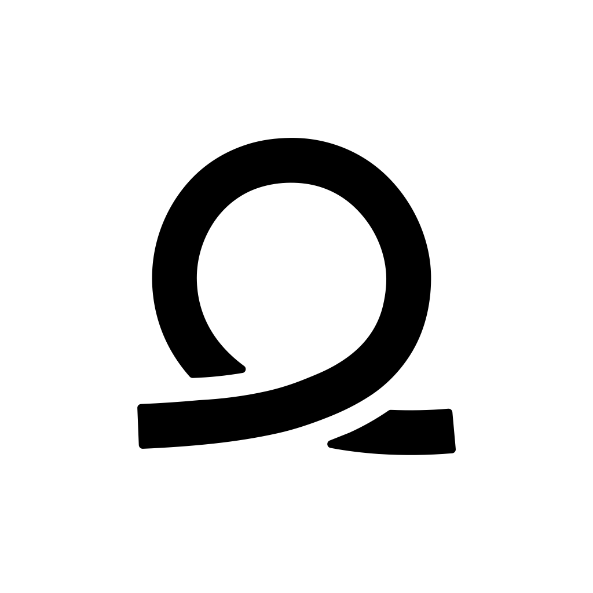

# Footage Flow

Footage Flow preps footage for editing. Drop videos into a folder; Footage Flow transcribes them, and NIP, its assistant, finds the takes and commands you spoke while filming and helps you cut the footage down. It saves the clips you keep to a searchable library on Google Drive, ready for CapCut or an editor.

NIP runs on Claude. The code, the `nip` command and the `~/NIP` folder keep the short name.

## Set up (Apple Silicon Mac)

```bash
brew install ffmpeg
```

```bash
python3 -m venv .venv && .venv/bin/pip install -e .
```

Homebrew's Python won't install packages globally, hence the venv. Run Footage Flow as `.venv/bin/nip`, or activate the venv first.

The first transcription downloads the Whisper model (about 1.6 GB).

## Use

Run `nip` (same as `nip view`). It opens Footage Flow in your browser and keeps processing the inbox while it runs.

For a double-click app, make one on your Desktop once:

```bash
osacompile -o ~/Desktop/"Footage Flow.app" -e 'do shell script quoted form of "'"$PWD"'/open-nip.sh"'
```

Give it the Footage Flow icon:

```bash
osascript -l JavaScript -e 'ObjC.import("AppKit"); $.NSWorkspace.sharedWorkspace.setIconForFileOptions($.NSImage.alloc.initWithContentsOfFile("'"$PWD"'/assets/app-icon.png"), "'"$HOME"'/Desktop/Footage Flow.app", 0)'
```

Opening it starts Footage Flow in the background, restarting it if it's already running so the latest code loads, and opens it in your browser after about 10 seconds. You can also bookmark `http://127.0.0.1:8765/` and refresh it while Footage Flow runs. Its output goes to `~/NIP/nip.log`.

1. **Drop footage in the inbox** (`~/NIP/inbox/`, or click *Open inbox* in the app). Each loose video becomes its own project. A folder of files becomes one project named after the folder. New footage shows up in the library within a minute or so.
2. **Inbox and library.** Every project is a card with a thumbnail, description, filmed and kept length, and its clip counts: kept (green), not marked yet (white) and cut (red). Footage moves through three stages, each with its own list in the sidebar: **Inbox** (raw footage; opening it to look, or naming it, doesn't move it), **Processing** (your first edit in it moves it here, or click **Start Processing**) and **Completed** (cut down, with its kept clips in the library). Drag a card onto any stage in the sidebar to move it there, back to the Inbox too; dragging one to Completed completes it, if every clip is marked. The app opens on the Inbox. In the Inbox or Processing, drag a card onto another to bundle them into one project and name the bundle; the videos are ordered by when they were filmed. Add footage with **Add Videos…** in the sidebar (a Finder window; the videos you pick move into the inbox), or drop videos anywhere on the window (they're copied in, and a file with the same name and size in Downloads goes to the Trash). Move the mouse across a card's picture to scrub through its footage without opening it. Its pencil button names it (bundled or not), and its text button shows everything said in it, to tell clips apart without sound. The trash button on any card moves its footage and edits to the Trash (drag the folder back into `~/NIP/library` to undo). If it has clips in the library it asks first, and deletes those too; on Drive they stay in Drive's trash for 30 days. Exports stay. Search finds anything in a project: description, tags, clip names, clip descriptions, notes, and every word said.
3. **Review the pre-edit.** A project opens on the cut version your voice commands made. The timeline shows only kept footage; everything removed (earlier and scratched takes, footage before the first take, the command words, pauses, silences, "cut everything up to here") is folded into a small bar showing its length. Playback plays the edit and skips those bars. Click a bar to open it: it plays through, and lists why each part was cut, with **Keep** or **Restore** to bring it back. Press <kbd>N</kbd> to name the footage from the start of the clip up to the playhead as a new clip ("curve throw in slow motion"), or <kbd>Shift</kbd>+<kbd>N</kbd> (or click the clip) to name the whole clip; naming a clip marks it keep, and named clips stay separate. You can also play, keep or cut a clip there. <kbd>M</kbd> writes a note for NIP. A bundle shows all its videos on one scrolling timeline and plays them as one video. Footage has three tiers: **cut** (red, folded away), **keep** (green: "NIP, keep", highlights, and what you mark), and **not marked** (plain). For a second pass, go through the plain footage: tap <kbd>C</kbd> or <kbd>K</kbd> to cut or keep the whole clip under the playhead (<kbd>K</kbd> on your own keep unmarks it); hold it to play and cut or keep just what plays while held; or <kbd>Shift</kbd>+<kbd>C</kbd> / <kbd>Shift</kbd>+<kbd>K</kbd> to cut or keep from the start of the clip up to the playhead. In the transcript, silences of a second or more show as markers with their length; click a clip's heading or edge to select the whole clip, or drag over words or click a silence to select just that, then keep, cut or name it the same way. Keeping cut text brings it back. Drag a clip's ends on the timeline to trim it, or out into the cut beside it to extend it. <kbd>M</kbd> then <kbd>←</kbd> or <kbd>→</kbd> merges a clip with its neighbour, undoing a NIP between them (anything cut between comes back), and restoring footage right after a clip joins it to that clip. <kbd>⌘Z</kbd> undoes and <kbd>⇧⌘Z</kbd> redoes. When you mark a project complete with footage still unmarked, NIP says how many stretches in how many clips and how much footage, and asks whether to cut or keep it. Also set a take's in and out with <kbd>I</kbd>/<kbd>O</kbd>, keep or drop takes with <kbd>T</kbd>, rename clips, and fix the description and tags. <kbd>Space</kbd> plays, <kbd>←</kbd>/<kbd>→</kbd> skip 2s (<kbd>Shift</kbd> for 10s). Your changes sit on top of the voice edit, so `nip reparse` keeps them; *Info → Reset My Changes* goes back to the voice edit.
4. **Work with NIP.** The editor fills the window: the transcript on the left (one paragraph per clip, green for keep, struck through for cut; click a word to jump there), the vertical video in the middle, and NIP on the right, with the controls and timeline along the bottom. **Details** in the toolbar holds the name, tags, export option and Reset; takes show above the transcript only when your voice commands used them. NIP's box does three things: <kbd>E</kbd> writes a note pinned to the playhead ("cut the stumble", "bring back the last line"), <kbd>Shift</kbd>+<kbd>E</kbd> a note on the whole video ("tighten every pause"), and **New edit** asks NIP to build an edit from a brief (step 5). Type or press the mic and say it. Go through the whole video, then hit **Apply Notes**: NIP reads the notes with the transcript and your current edit, and sends back edit operations (cut, restore a cut, keep or drop a take, move a take's in or out, rename a clip). Footage Flow checks each one before applying it. Each note then shows what changed, or why it couldn't be done. Tick **Apply now** to have each note done as soon as you add it. **Undo Last Apply** reverts the last batch. Speech uses your browser's built-in recognition; in Chrome that audio goes to Google.
5. **Edit with NIP** for talking-heavy footage. Write a brief like "give me a 30 second video where I explain why Linderballs are great". NIP reads the transcript and your clip descriptions, picks lines and described clips, and saves the result as an edit you can preview and export as one video. It never sees the video, only what was said and how you described it.

   NIP runs on Claude through [Claude Code](https://claude.com/claude-code), so they count against your Claude plan's usage, not a separate bill. Sign Claude Code in once:

   ```bash
   claude
   ```

   Then type `/login` and follow the browser steps. If Claude Code isn't installed, Footage Flow falls back to the Anthropic API (set `ANTHROPIC_API_KEY`; billed per use in the Anthropic Console).

6. **Mark Complete.** When you've gone through every clip, **Mark Complete** takes you back to the main screen and cuts the footage down in the background, saving each kept clip to the library. A panel in the corner shows the progress, and you can keep working; completing more footage queues it behind. When it's done the project moves to Completed. If anything goes wrong, the panel says why and the project stays in Processing, with the library unchanged. While it saves, the project can't be changed, so nothing you do gets lost. Completed footage opens with only its kept clips: nothing that was cut shows on the timeline, in the transcript or on its card. You can still trim it, cut more, split it or rename clips; it stays in Completed, and when you leave the video (or click **Update Library**) the new clips replace the old ones, and tags stay. Drive keeps the replaced clips in its own trash for 30 days. To bring back something that was cut, click **Completed** to reopen it in Processing, then Mark Complete again. Library folders with no project here show in Completed under **Clips Only**, with a trash button of their own.

The terminal commands still work: `nip ingest` once, `nip watch` to keep checking, `nip report`, `nip reparse`, `nip retranscribe` (transcribe a project again; keeps a `.bak` of each old transcript), and `nip finalize` (the same as Mark Complete).

**What Complete saves.** Each kept clip becomes its own file in the library, named after the clip. The library is `My Drive/Footage Flow/Library` on Google Drive, set by `library` in `~/NIP/settings.json` (`~/NIP/finalized` without one). Each bundle's folder is named after it, then the date, like `Help me name my printers (2026-11-04)`. Rename a bundle and its folder follows the next time you mark it complete. It starts in `Library/Unused`. The folder holds just its clips, plus an `_info` folder with each clip's `.json` (name, tags, source, transcript with times from the start of the clip), thumbnail and small preview, so browsing never downloads the full clip. Clips are built and checked on this Mac and copied over whole, and `~/NIP/clips-index.json` keeps search working when Drive is slow or offline. Files are cut without re-encoding, so they're the original quality and keep their date and location; a clip can run a fraction of a second long at its end, and starts on a keyframe up to about a second earlier that players hide. The original footage isn't touched. Set `NIP_FINAL` to save elsewhere.

**Filming source.** Every clip saved to the library is tagged `iphone` or `meta glasses`, read from the video file's own metadata, so the tag list under **All Clips** sorts by what filmed it. Footage from anything else gets no such tag.

**Sorting clips.** Mark Complete first asks how to sort the bundle, so you don't tag clip by clip: **Talking head** (every clip is a one-off, tagged `talking head`), **Mixed** (Claude marks clips with no significant talking, or that mention throwing or gameplay, as reusable and the rest as one-offs), **All gameplay or throwing** (every clip is reusable, with the tags you tick or type) or **Custom** (type what you want and Claude follows it). Nothing is cut by this; every kept clip still goes to the library. **Skip** leaves clips as they are. A video you sorted by voice while filming ("NIP, this video is gameplay") keeps what you said, and the prompt only covers the rest; if you sorted them all, it doesn't appear. Claude reads clip names and what's said, not the picture. If it fails, the panel says why and the project stays in Processing. The menu in the Library shows Reusable, One-off or Not sorted clips, and a clip's details change it by hand. Updating completed footage keeps its sorting. To sort a bundle that's already saved, or change your mind, hover its card in Completed and click the tag: the same choices, but only the labels change, so nothing is cut or uploaded again. Videos sorted by voice keep what you said.

**Library.** **All Clips** in the sidebar shows every kept clip from every completed project, with your clip tags listed under it. Search by name, tag, bundle or anything said, and sort by date, length or name. Move across a picture to preview; click one to play it, tag it, or show its file in Finder. Tags belong to the clip and survive completing it again. Unnamed clips show their first words.

**Used and unused.** Once a bundle's been used in a video, hover its card in Completed and click the check to mark it used: its folder moves from `Library/Unused` to `Library/Used`, and Completed lists the two apart. The arrow moves it back. You can also just move the folder yourself in Drive; the app goes by where it sits. The Library can show only used or only unused clips.

**Ask NIP.** NIP sits beside the library on the home screen; press <kbd>E</kbd> to talk to it. Ask about your footage or how the app works, have it find clips ("find clips where I throw"), or tell it to do something: open a project, pick or tag clips, export them, rename a project, mark one used or unused, move it to the Inbox or Processing, or complete it. It sees every project and the start of each clip's transcript, and it can't delete anything or change cuts from here. A reload starts the conversation fresh. It runs on Claude, like NIP in the editor.

**Tag clips together.** With clips selected, **Tags…** in the bar at the bottom adds or removes tags on all of them at once: the common ones are ticked or unticked, there's a box for new ones, and you can mark them all reusable or one-off.

**Export clips for a video.** Click the top half of a clip's picture to select it, or the bottom half to play it and see its details. Once something's selected, clicking anywhere on another clip selects it too, and only the strip along the bottom of a picture plays. Picks stay while you search, so one video can gather clips from many searches. **Export…** asks for the video's name and copies the clips, numbered in the order you picked them, to their own folder in `Footage Flow/Handoffs` beside the library, where an editor can reach them too.

**Your words.** **Vocabulary…** in the sidebar opens `~/NIP/vocabulary.txt`: one word or name per line, or `what it hears = how it's spelled` for a mistake (`bamboo lab = Bambu Lab`). The words bias Whisper on new footage, and the spellings apply to every transcript, old ones too, as soon as you reload; saved transcripts stay as Whisper heard them.

**Silence that isn't speech.** Over silent or noisy footage, Whisper invents words: loops like "old old old…", stray "Thank you.", or random foreign words. Footage Flow drops any stretch Whisper wasn't confident about (real speech averages 0.85+ word confidence, made-up words under 0.1) and any phrase repeated 3+ times in a row (a single word 5+), keeping them aside as `noise` in the clip's `.nip.json`. Voice commands are never dropped, and saying something twice, like a retake, stays. Transcripts made before this get the loop check with `nip reparse`; `nip retranscribe` gives them the confidence check too.

An edit by NIP exports as one video to `~/NIP/exports/<project>/`. Originals stay untouched in `~/NIP/library/<project>/raw/`.

NIP's edits are sized for Instagram Reels, TikTok and YouTube Shorts: 1080×1920 for vertical footage (the short side is scaled to 1080, never up), the original frame rate, and HEVC at 16 Mbps with iPhone HDR kept. That's an editing copy for CapCut, about a fifth the size of iPhone 4K. In CapCut, export at 1080p with the source frame rate. Each platform re-encodes what you upload.

`report`, `reparse`, `retranscribe` and `finalize` act on the newest project by default. Pass part of a folder name to pick another, for example `nip finalize linderball`.

With the library on Google Drive, an `Inbox` folder sits beside it (`My Drive/Footage Flow/Inbox`), so you can add footage from your phone or another computer. While the app runs, each video there is downloaded into the local inbox and then deleted from Drive, where Drive's trash keeps it for 30 days. A folder of videos becomes one project, as it does locally.

## Voice commands

Start every command with "NIP" and pause for a second or two after it, so NIP knows where the command ends and your speech begins.

| Say | What NIP does |
|---|---|
| "NIP, new clip" / "NIP, clip two, curve throw" | Starts a new clip, optionally named. Its takes compete only with each other, and the best one is kept. Footage right after it counts as take one. |
| "Take one", "Take two", … | Starts a take. Say it as its own phrase, with a short pause before and after, or as "NIP, take two". The last take in a run is kept. Without "new clip", starting again from the same or a lower number starts a new section; after "new clip", a repeated number is just another take. |
| "Scratch that" / "Scrap that" / "Reset" | Drops the current take. "Reset" needs a pause on both sides, or "NIP" before it. |
| "NIP, this is …" | Sets the project description. The project folder is renamed to match. |
| "NIP, tag …" | Adds a tag to the whole bundle. |
| "NIP, this video is gameplay" / "… throwing and funny" | Tags every clip from this video. Gameplay and throwing also mark them reusable, and "talking head" marks them one-offs, so Mark Complete doesn't have to ask. "NIP, gameplay" works too. |
| "NIP, this video is non-reusable" / "NIP, one-off" / "NIP, reusable" | Sets just that, for every clip from this video. |
| "NIP, best take" / "NIP, that's the best one" | Keeps this take instead of the last one in the clip. |
| "NIP, pause" … "NIP, resume" | Cuts everything between them. A pause with no resume cuts to the end of the take. |
| "NIP, cut the silence" | Shortens every pause longer than 1 second in this take. |
| "NIP, mark that" / "highlight" | Adds a marker. |
| "NIP, cut" / "NIP, cut that" | Cuts everything since the last NIP command (or the start of the take). |
| "NIP, keep" / "NIP, keep that" | Marks everything since the last NIP command keep (green). |
| "NIP, let me try that again" | Cuts back to the last pause of at least 1 second. |
| "NIP, cut everything up to here" | Cuts from the start of the current clip or take up to here. |
| "NIP" (nothing after), or "NIP split" | A divider: a reference point for "NIP, cut", "NIP, keep" and "tag that". It also splits the footage there into two clips in the editor, neither cut nor kept. In the editor, **Split** (S) does the same by hand. |
| "NIP, tag that as …" | Like "NIP, keep", with a label. |
| "NIP, clip the last 10 seconds" / "NIP, cut the last 5 seconds" | Marks those seconds keep, or cuts them. |
| "NIP, that was …" | Adds a note on what you just filmed to the report. |
| "NIP, …" anything else | Listed as not understood in the report, for now. |

NIP always cuts the command words themselves. Footage before the first "take" is dropped. Videos without any take or clip commands are kept whole.

## Tuning

Command rules live in `nip/commands.py`. After changing them, run `nip reparse` to re-apply them to the saved transcripts without transcribing again.
